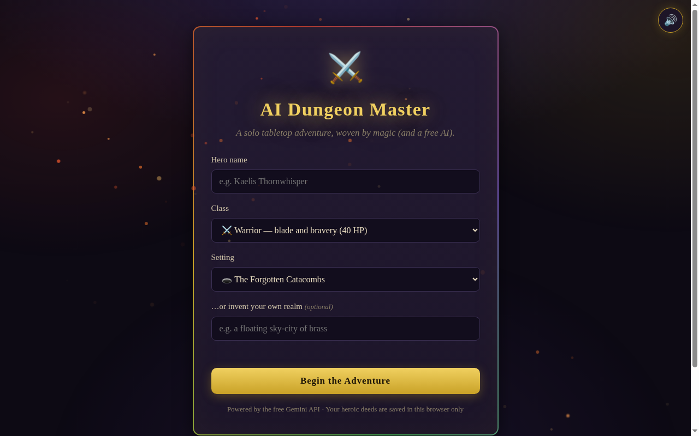

# ⚔️ AI Dungeon Master

## Screenshot




A solo Dungeons & Dragons–style adventure game in your browser. Create a hero, pick a realm (or invent your own), and an AI Dungeon Master weaves a living story around every choice you make — complete with dice rolls, hit points, inventory, and a quest log.

**100% free to run** — powered by the free Gemini API. No build step, no bundler, no paid services.


## ✨ Features

- **Hero creation** — name, 5 classes (Warrior, Rogue, Mage, Ranger, Cleric — each with its own HP **and starting kit**), 3 realms or a fully custom setting
- **Living story** — the AI narrates in vivid second person, reacts to your dice rolls, and ends every reply with 3 clickable quick-choice actions
- **Code owns the numbers** — every DM reply ends with a machine-readable `STATE:` block (HP/gold/XP/item/foe/objective deltas). The client applies, clamps, and levels up — the DM's prose can never fudge a number
- **XP + levels** — earn XP for real progress; level-ups grant +5 max HP and +5 HP
- **Gold** — loot, track, and spend gold across the campaign
- **Objectives** — every campaign draws 2 win conditions (escape, slay the boss, claim the artifact, rescue the captive, uncover the secret). Complete them all for victory
- **Code-owned combat** — when a foe appears, Attack / Defend / Flee resolve with real dice in the client; the DM only narrates the outcome the dice decided
- **Achievements** — 7 code-checked honors (First Roll, Natural Twenty, First Blood, Survivor, Hoarder, Quest Master, Legend) with toast + chime
- **Typewriter narration** — story text types out like a bard's tale (click to skip)
- **Dice roller** — d20/d12/d10/d8/d6/d4 with roll animation, critical hit/fumble flair, send-as-action or insert-into-input
- **Character panel** — HP bar with damage/heal controls, gold/XP/level/turn stats, inventory list, quest log with completion tracking (+10 XP per completed quest)
- **3 save slots + autosave** — full campaign state (story history + character + objectives + honors) persisted in `localStorage`; silent autosave after every reply, resumable from the setup screen
- **Chronicle export** — one-click download of the whole campaign as a readable `.md` tale
- **Dark-fantasy UI** — ember particles, gold-on-obsidian theme, fully mobile-responsive
- **Synthesized SFX** — zero-asset WebAudio sound engine: dice rattles, critical-hit fanfares, fumble buzzes, quest-complete jingles, whooshes on every send (mutable, persisted)
- **Canvas VFX** — ambient rising embers, confetti bursts on nat 20s and quest completions, screen shake on nat 1s, sparkles on quick choices; auto-quality scaling + `prefers-reduced-motion` support

## 🚀 Run locally

**Requirements:** Node.js 20+ and a free Gemini API key from [Google AI Studio](https://aistudio.google.com/apikey).

```bash
npm install
cp .env.example .env
# edit .env and paste your key into AI_API_KEY
npm start
```

Open http://localhost:3000 and begin your adventure. 🐉

## ☁️ Deploy to Render (free)

1. Push this repo to GitHub.
2. In [Render](https://render.com), click **New → Web Service** and select the repo (or **New → Blueprint** and point it at `render.yaml`).
3. Set the **AI_API_KEY** environment variable to your free Gemini key.
4. Deploy — Render builds with `npm install` and starts with `npm start`. Your game is live at the URL Render gives you.

## 🔑 Environment variables

| Variable      | Required | Default                                                        | Description                                      |
|---------------|----------|----------------------------------------------------------------|--------------------------------------------------|
| `AI_API_KEY`  | Yes      | —                                                              | Free Gemini API key (Google AI Studio). Never commit it. |
| `PORT`        | No       | `3000`                                                         | HTTP port (Render sets this automatically).      |
| `AI_MODEL`    | No       | `gemini-3.8-flash`                                             | Model name sent to the OpenAI-compatible endpoint. |
| `AI_BASE_URL` | No       | `https://generativelanguage.googleapis.com/v1beta/openai`      | OpenAI-compatible chat completions base URL.     |
| `FRONTEND_URL`| No       | (open)                                                         | Comma-separated CORS allowlist. Set in production. |

## 🧪 Tests

```bash
npm test   # pure-logic unit tests: dice, choice/STATE parsers, HP/XP, combat, achievements, chronicle (36 tests)
```

## 🗂️ Project structure

```
├── index.html          # setup screen + game screen markup (objectives / combat / honors panels)
├── css/style.css       # dark-fantasy theme, responsive + toast/combat styles
├── js/app.js           # game state, UI wiring, AI chat flow, STATE consequences, combat
├── js/logic.js         # pure logic (dice, parsers, deltas, combat, achievements, chronicle) — unit tested
├── js/sfx.js           # zero-asset WebAudio synth engine
├── js/vfx.js           # canvas particles (embers, confetti, sparkle, shake)
├── server.js           # hardened Express API: /api/health, /api/ready, /api/chat (STATE contract in prompt)
├── test/logic.test.mjs# unit tests for js/logic.js
├── PLAN.md             # vision, architecture, teardown learnings, future ideas
├── render.yaml         # one-click Render deploy
└── .env.example        # environment template
```

## 🛡️ Backend notes

- `helmet`, CORS allowlist, per-IP rate limiting (`express-rate-limit`), request validation, and a 60-second upstream timeout.
- The API key lives **only** in the `AI_API_KEY` env var — it is never sent to the browser.
- All failures return graceful JSON (`{ error: "..." }`); the server never crashes and never leaks stack traces or keys.

## 📜 License

MIT — see [LICENSE](LICENSE).

---

**Crafted by [Vivek Nair](https://github.com/vivekn4) · VN**
